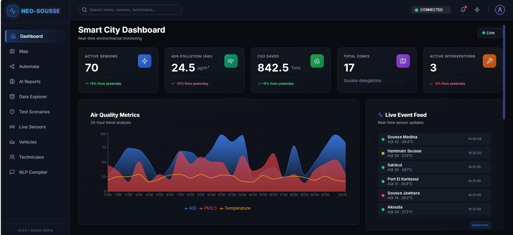
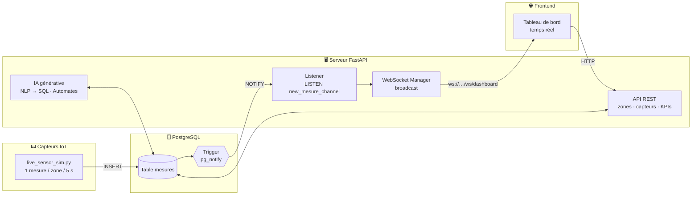

<div align="center">

# 🏙️ Smart City Tunisia

### Plateforme intelligente de surveillance urbaine en temps réel
<div align="center">



</div>

*Un backend FastAPI, un flux WebSocket temps réel, une couche d'IA générative
et un dashboard web pour surveiller la ville de Sousse : capteurs IoT,
pollution, température, interventions et mobilité.*


</div>

---

## 📑 Sommaire

- [Aperçu](#-aperçu)
- [Démo](#-démo)
- [Fonctionnalités](#-fonctionnalités)
- [Architecture](#-architecture)
- [Stack technique](#-stack-technique)
- [Structure du dépôt](#-structure-du-dépôt)
- [Démarrage rapide](#-démarrage-rapide)
- [Frontend — Dashboard](#-frontend--dashboard)
- [Installation détaillée](#-installation-détaillée)
- [WebSocket temps réel](#-websocket-temps-réel)
- [Référence de l'API](#-référence-de-lapi)
- [FAQ](#-faq)
- [Équipe & contexte](#-équipe--contexte)

---

## 🔍 Aperçu

**Smart City Tunisia** est un système complet de ville intelligente
(IoT + Intelligence Artificielle) appliqué à **Sousse (Tunisie)** et à ses
17 délégations. Il comprend un **backend** (API + temps réel) et un
**dashboard web** (NEO-SOUSSE).

Des capteurs IoT mesurent en continu la **pollution**, la **température**
et l'**humidité** de chaque zone. Chaque nouvelle mesure déclenche un
événement PostgreSQL (`NOTIFY`) qui est capté par le serveur puis diffusé
instantanément par **WebSocket** au tableau de bord. L'API gère aussi les
zones, capteurs, interventions, techniciens, véhicules, trajets et citoyens,
et propose des fonctions avancées : rapports par IA générative, questions
en langage naturel converties en SQL, et automates finis.

---

## 🎬 Démo

### Dashboard NEO-SOUSSE


### Documentation interactive (Swagger)


### Flux temps réel (WebSocket)


---

## ✨ Fonctionnalités

| | |
|---|---|
| 📡 **Temps réel** | PostgreSQL NOTIFY → WebSocket → tableau de bord |
| 📊 **Gestion des mesures** | Pollution (µg/m³), température (°C), humidité (%) par zone |
| 📈 **KPIs globaux** | Un seul appel pour le tableau de bord de la ville |
| 🤖 **IA générative** | Rapports (pollution, température…) et suggestions d'actions |
| 🗣️ **Langage naturel → SQL** | Poser une question en français, obtenir les résultats |
| ⚙️ **Automates finis** | Transitions d'états des équipements |
| 🔧 **Maintenance** | Interventions, techniciens, statut des capteurs |
| 🚗 **Mobilité** | Véhicules, trajets et CO₂ économisé |

---

## 🏗️ Architecture



### 🔔 Principe du temps réel

1. Le simulateur insère une mesure dans la table `mesures`.
2. Un **trigger PostgreSQL** (`AFTER INSERT`) envoie une notification
   `pg_notify` contenant la ligne au format JSON.
3. Le **listener** (thread daemon lancé au démarrage de FastAPI) reçoit
   l'événement et l'enrichit avec `nom_zone` et `type_zone`.
4. Le **gestionnaire WebSocket** diffuse le message à tous les clients
   connectés sur `/ws/dashboard`.

---

## 🧰 Stack technique

<div align="center">

| Couche | Technologies |
|---|---|
| **API** | Python 3.11+, FastAPI, Uvicorn |
| **Base de données** | PostgreSQL 14+, SQLAlchemy, psycopg2 |
| **Temps réel** | WebSocket, PostgreSQL LISTEN/NOTIFY |
| **Validation** | Pydantic |
| **IA** | OpenAI API |
| **Configuration** | python-dotenv |
| **Frontend** | Dashboard web NEO-SOUSSE (à compléter : framework, graphiques) |

</div>

---

## 📁 Structure du dépôt

```
Smart-City-Tunisia/
├── README.md                # Ce fichier
├── demo/                    # Images et GIF de démonstration
│   ├── banner.png
│   ├── demo1.png
│   └── demo2.gif
├── backend/                 # API FastAPI + WebSocket
│   ├── main.py              # Point d'entrée
│   ├── live_sensor_sim.py   # Simulateur de capteurs IoT
│   ├── seed_data.py         # Peuplement initial de la base
│   ├── requirements.txt
│   ├── database/            # Connexion, init DB, listener NOTIFY
│   ├── websocket/           # Gestionnaire des connexions WebSocket
│   ├── models/              # Modèles SQLAlchemy (ORM)
│   ├── routes/              # Endpoints API REST
│   ├── schemas/             # Schémas Pydantic
│   └── services/            # IA générative, compilateur NLP→SQL, automates
└── frontend/                # Dashboard web NEO-SOUSSE
```

> 🔧 Adapte les noms de dossiers à ton arborescence réelle.

---

## 🚀 Démarrage rapide

| Composant | Instructions |
|---|---|
| 🖥️ Backend | Voir [Installation détaillée](#-installation-détaillée) ci-dessous |
| 🌐 Frontend | Voir [Frontend — Dashboard](#-frontend--dashboard) ci-dessous |

```bash
# ── Backend ──────────────────────────────────────────
cd backend
python -m venv venv
venv\Scripts\activate          # Windows  (Linux/macOS : source venv/bin/activate)
pip install -r requirements.txt

# Configurer le .env (voir plus bas), puis peupler la base
python seed_data.py

# Terminal 1 : API + WebSocket
uvicorn main:app --reload --host 0.0.0.0 --port 8000

# Terminal 2 : simulateur IoT temps réel
python live_sensor_sim.py

# ── Frontend ─────────────────────────────────────────
# Terminal 3 (voir la section Frontend)
cd frontend
npm install
npm run dev
```

Accès : **http://localhost:8000/docs** (Swagger) et l'adresse affichée par
le frontend pour le dashboard.

---

## 🌐 Frontend — Dashboard

Dashboard web **NEO-SOUSSE** connecté à l'API REST et au WebSocket
(`ws://localhost:8000/ws/dashboard`). Le badge **CONNECTED / DISCONNECTED**
en haut à droite indique l'état du flux temps réel.

| Page | Description |
|---|---|
| 🏠 **Dashboard** | KPIs de la ville, courbes de qualité de l'air sur 24 h, flux d'événements en direct |
| 🗺️ **Map** | Carte des zones et capteurs |
| ⚙️ **Automata** | Automates finis (transitions d'états) |
| 🤖 **AI Reports** | Rapports et suggestions par IA générative |
| 🗄️ **Data Explorer** | Exploration des données |
| 🧪 **Test Scenarios** | Scénarios de test |
| 📡 **Live Sensors** | Mesures des capteurs en temps réel |
| 🚗 **Vehicles** | Véhicules et trajets |
| 👨‍🔧 **Technicians** | Techniciens et interventions |
| 🗣️ **NLP Compiler** | Questions en langage naturel converties en SQL |

> 🔧 Complète cette section avec les technologies du frontend (framework,
> bibliothèque de graphiques…) et vérifie les commandes de lancement.

---

## ⚙️ Installation détaillée

### 1. Prérequis

- Python 3.11+
- PostgreSQL 14+
- pip

### 2. Dépendances

Contenu du `requirements.txt` :

```
fastapi
uvicorn
sqlalchemy
psycopg2-binary
python-dotenv
pydantic
openai
```

| Package | Rôle |
|---|---|
| `fastapi` | Framework API REST + WebSocket |
| `uvicorn` | Serveur ASGI |
| `sqlalchemy` | ORM Python ↔ PostgreSQL |
| `psycopg2-binary` | Driver PostgreSQL (LISTEN/NOTIFY, insertions directes) |
| `python-dotenv` | Lecture du fichier `.env` |
| `pydantic` | Validation et sérialisation des données |
| `openai` | Rapports et suggestions IA |

### 3. Créer la base de données

```sql
CREATE DATABASE smart_city_db;
```

### 4. Configurer le fichier `.env`

Créer un fichier `.env` à la racine du projet :

```env
DB_USER=smart_user
DB_PASSWORD=votre_mot_de_passe
DB_HOST=localhost
DB_PORT=5432
DB_NAME=smart_city_db
```

> ⚠️ Ne jamais commiter le `.env` : l'ajouter au `.gitignore`.

### 5. Créer les tables

Les tables sont créées automatiquement au démarrage du serveur
(`init_db()` dans le hook `on_startup`) :

```bash
uvicorn main:app --reload
```

### 6. Peupler la base

```bash
python seed_data.py
```

Insère les zones de Sousse (17 délégations), capteurs, techniciens,
véhicules, citoyens et un historique de mesures simulées.

### 7. Créer le trigger PostgreSQL

```sql
-- Fonction qui envoie la notification
CREATE OR REPLACE FUNCTION notify_new_mesure()
RETURNS trigger AS $$
BEGIN
  PERFORM pg_notify(
    'new_mesure_channel',
    row_to_json(NEW)::text
  );
  RETURN NEW;
END;
$$ LANGUAGE plpgsql;

-- Trigger sur la table mesures
CREATE TRIGGER mesure_insert_trigger
AFTER INSERT ON mesures
FOR EACH ROW
EXECUTE FUNCTION notify_new_mesure();
```

> ✅ Vérification : `\df notify_new_mesure` dans psql doit retourner la fonction.

---

## 🔌 WebSocket temps réel

```
ws://localhost:8000/ws/dashboard
```

**Connexion côté frontend :**

```javascript
const ws = new WebSocket("ws://localhost:8000/ws/dashboard");

ws.onmessage = (event) => {
  const message = JSON.parse(event.data);

  if (message.type === "NEW_MESURE") {
    console.log("Nouvelle mesure :", message.data);
    // {
    //   "id_mesure": 1042,
    //   "timestamp": "2026-04-29T14:30:05.123",
    //   "pollution": 23.7,
    //   "temperature": 28.4,
    //   "humidite": 61.2,
    //   "id_zone": 65,
    //   "nom_zone": "Sousse Medina",
    //   "type_zone": "historique"
    // }
  }
};
```

**Pourquoi `AFTER INSERT` ?** La notification n'est envoyée qu'une fois la
ligne bien enregistrée en base.

---

## 📡 Référence de l'API

Documentation complète et testable sur `http://localhost:8000/docs`.

| Module | Préfixe | Description |
|---|---|---|
| 🗺️ Zones | `/zones` | CRUD des délégations (type, surface, population, coordonnées) |
| 📟 Capteurs | `/capteurs` | CRUD, capteurs par zone, changement de statut (`actif`, `maintenance`, `hors_service`) |
| 📊 Mesures | `/mesures` | CRUD, filtres (`id_zone`, `depuis`, `jusqu`, pagination), dernières mesures, mesure live |
| 🔧 Interventions | `/interventions` | CRUD, interventions par zone |
| 👨‍🔧 Techniciens | `/techniciens` | CRUD, champ `disponible` |
| 🚗 Véhicules | `/vehicules` | CRUD (`actif`, `en_maintenance`, `hors_service`) |
| 🛣️ Trajets | `/trajets` | Distance, durée, CO₂ économisé |
| 👥 Citoyens | `/citoyens` | CRUD |
| 🏠 Propriétaires | `/proprietaires` | CRUD |
| 🗨️ Consultations | `/consultations` | Consultations citoyennes liées aux zones |
| 📈 KPIs | `/kpis/dashboard` | Tableau de bord global en un appel |
| 🤖 IA | `/ia/rapport`, `/ia/suggestions`, `/ia/valider` | Rapports, suggestions et validation d'états par IA |
| 🗣️ NLP → SQL | `/nl/query` | Question en langage naturel convertie en SQL |
| ⚙️ Automates | `/automates` | Automates finis (transitions d'états) |

**Exemple : question en langage naturel**

```json
POST /nl/query
{ "phrase": "quelles sont les zones avec une pollution supérieure à 50 ?" }
```

**Exemple : réponse de `/kpis/dashboard`**

```json
{
  "smart_city": "Tunisia 🇹🇳",
  "zones": 17,
  "capteurs": { "total": 85, "actifs": 70, "en_maintenance": 10, "hors_service": 5 },
  "mesures": {
    "total": 12500,
    "derniere_mesure": "2026-04-29T14:30:05",
    "moyennes": { "pollution_µg_m3": 24.5, "temperature_C": 27.3, "humidite_pct": 63.1 }
  },
  "interventions": { "en_cours": 3, "critiques": 1 },
  "vehicules": { "total": 20, "actifs": 15 },
  "environnement": { "co2_economise_kg_total": 842.5 },
  "techniciens_disponibles": 8,
  "citoyens": 450
}
```

### 🔗 URLs utiles

| URL | Description |
|---|---|
| `http://localhost:8000/docs` | Swagger interactif |
| `http://localhost:8000/redoc` | ReDoc |
| `http://localhost:8000/health` | Health check API + base de données |
| `ws://localhost:8000/ws/dashboard` | WebSocket temps réel |

---

## ❓ FAQ

**Le trigger ne se déclenche pas.**
Vérifier que la fonction ET le trigger ont été créés, puis tester :
`INSERT INTO mesures (timestamp, temperature, humidite, pollution, id_zone) VALUES (NOW(), 25.0, 60.0, 30.0, 65);`

**Le WebSocket ne reçoit rien.**
Vérifier que `live_sensor_sim.py` tourne, que le listener est actif (log
`📡 Listening PostgreSQL events...` dans uvicorn) et que le trigger existe.

**`psycopg2.OperationalError`**
Vérifier les variables du `.env` et que PostgreSQL accepte les connexions
depuis localhost.

**`ModuleNotFoundError`**
Activer l'environnement virtuel et réinstaller les dépendances.

---

## 👥 Équipe & contexte

Ce projet a été réalisé dans le cadre d'un **projet académique**.

> Ines Gardabbou

---
